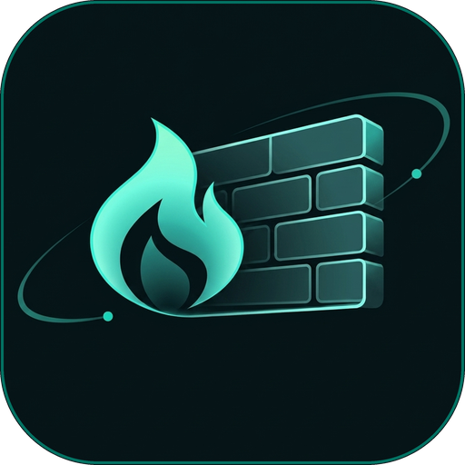

<div align="center">
  
  <h1>Causal Firewall</h1>
  <p>
    <strong>Audit live websites, isolate real root causes, and prove every fix on 5% traffic before touching 100% of users.</strong>
  </p>
  <p>
    <a href="https://causal-firewall-main.vercel.app"><strong>Launch Live Web App &rarr;</strong></a>
  </p>
  <p>
    
    
    
    
  </p>
</div>

---

## What Is Causal Firewall? (In Plain English)

When a website or web app slows down, throws errors, or gets flagged for security gaps, teams usually **guess** a quick fix under pressure:

- *"Let's restart the server."*
- *"Let's clear the cache or add more RAM."*
- *"Let's deploy an unverified AI patch directly to all visitors."*

Guessing in production is risky — restarting servers kicks users out of checkout, and unverified patches often mask symptoms or break something else for 100% of your visitors.

**Causal Firewall acts as a smart safety gate in front of your fixes:**

```text
  Website / Bug Report
           │
           ▼
  ┌─────────────────────────┐
  │ 1. Measure Real Signals │  HTTP status, latency, headers, bundles & error logs
  └─────────────────────────┘
           │
           ▼
  ┌─────────────────────────┐
  │ 2. Isolate Root Cause   │  Separate real causes from temporary band-aids
  └─────────────────────────┘
           │
           ▼
  ┌─────────────────────────┐
  │ 3. 5% Shadow Canary     │  Test the fix on 5% traffic while 95% stay safe
  └─────────────────────────┘
           │
     ┌─────┴─────┐
     ▼           ▼
  p < 0.05     Unproven
  GATE OPENS   GATE HELD
  (Safe 100%)  (95% Protected)
```

---

## Core Sections at a Glance

| Tab | Key | What It Does |
|---|---|---|
| **01 Console** | <kbd>1</kbd> | Overview dashboard with approval rate, decision history, search/filters, side-by-side comparison, and CSV/JSON exports. |
| **02 Run scenario** | <kbd>2</kbd> | Test fixes safely across 8 realistic outage scenarios (retry storms, DB deadlocks, memory leaks, DNS failures, expired certs, etc.). |
| **03 AI Doctor** | <kbd>3</kbd> | Paste any stack trace, bug, or load-test error log to isolate the root cause, spot rookie traps, and get copy-paste code patches. |
| **04 Site Auditor** | <kbd>4</kbd> | Paste **any live website or webapp URL** for real HTTP, security header, broken asset, and high-traffic crash readiness checks. |
| **05 Causal trace** | <kbd>5</kbd> | Step-by-step visual inspection of the evidence trail (`Request -> Signals -> Hypothesis -> Metric Delta -> Policy Rules -> Decision`). |
| **06 Scenario builder** | <kbd>6</kbd> | Create your own custom team incident scenarios with candidate fixes to test internally. |
| **07 Settings** | <kbd>7</kbd> | Manage your AI API key, test live connectivity, switch **Dark / Light** theme, export audit reports, or clear local history. |

---

## How to Use Causal Firewall

### 1. Audit Any Live Website URL (`04 Site Auditor`)
Best when you want to check if a live website or web app has hidden bugs, security gaps, or high-traffic crash risks.

1. Open **`04 Site Auditor`** (or press <kbd>4</kbd>).
2. Paste your website link (for example, `https://yourwebsite.com`).
3. *(Optional)* Check **"Run safe 6x concurrency mini-burst check"** if you own or have permission to test that site and want to see whether response times spike under parallel requests.
4. Click **Scan Website**.

You will immediately receive **100% real measured telemetry** (zero synthetic numbers):
- **Functioning & Broken Bundles:** Live HTTP status, redirect chain hops, TTFB latency, missing viewport/title/meta tags, and automatic spot-checks of linked JS/CSS files for `404` or `500` errors.
- **Defensive Security Posture:** HTTPS enforcement & HTTP-to-HTTPS redirect check, HSTS, `Content-Security-Policy`, clickjacking protection (`X-Frame-Options` / `frame-ancestors`), `X-Content-Type-Options: nosniff`, `Referrer-Policy`, `Permissions-Policy`, cookie flags (`HttpOnly`, `Secure`, `SameSite`), wildcard CORS checks, mixed HTTP content, and leaked error trace or credential patterns (automatically redacted).
- **High-Traffic Crash Readiness:** CDN/edge cache coverage (`Cache-Control`, Cloudflare/Vercel headers, static `/assets/` immutability), `gzip`/`brotli` compression, payload weight, and burst latency degradation.
- **Local Stress-Test Lab (100 – 250+ Users):** Pre-built **`npx autocannon`** and **`k6`** scripts tailored to your exact URL so you can run full high-user load tests safely from your own terminal.
- **Verified Remediation + Shadow Gate:** Copy-paste configuration fixes (`vercel.json`, Express middleware, HTTP headers) and a **"Test Fix in Causal Firewall"** button to validate them through the 5% shadow cohort.

---

### 2. Diagnose Website Errors & Slowdowns (`03 AI Doctor`)
Best when users report a runtime bug, API timeout, or crash log.

1. Open **`03 AI Doctor`** (or press <kbd>3</kbd>).
2. Paste an error log, stack trace, or plain-English symptom (or pick a built-in template like *Next.js Stripe 504 Timeout* or *React Memory Leak*).
3. Click **Diagnose & Generate Fixes**.
4. Review the **At a Glance** verdict, root cause explanation, anti-hallucination safety audit, **3 ranked candidate fixes** (*Causal Fix* vs *Temporary Trap* vs *Ineffective Guess*), and copy-paste solution code.
5. Click **Test 5% Shadow Cohort** on any candidate fix to verify it inside **05 Causal trace**.

---

### 3. Test Fixes Safely Before Rollout (`02 Run scenario` & `05 Causal trace`)
Best for testing remediation playbooks without risking live visitors.

1. Open **`02 Run scenario`** (<kbd>2</kbd>).
2. Pick an incident from the library and choose an intervention to test.
3. Click **Evaluate intervention** (<kbd>E</kbd>) — or click **Batch all** (<kbd>B</kbd>) to test all 3 interventions at once.
4. Explore the decision inside **`05 Causal trace`** (<kbd>5</kbd>):
   - **Gate Opened (`allow`):** Metric improved significantly ($p < 0.05$) with blast radius safely capped at 5%.
   - **Gate Held (`review`):** Improvement was inconclusive or masked symptoms temporarily — blocked to protect the other 95% of visitors.

---

### 4. Compare Fixes & Export Post-Mortem Reports (`01 Console`)
1. Go to **`01 Console`** (<kbd>1</kbd>).
2. Click the compare icon (`⇆`) next to any two past evaluations, then click **Compare selected** to view confidence deltas and winning decisions side by side.
3. Click **Export JSON** or **Export CSV** (also available in **07 Settings**) to download clean reports for team post-mortems and incident audits.

---

### 5. Integrate with Live Production Traffic
Use middleware in your Next.js, Express, or Cloudflare Workers app to keep 95% of real visitors untouched while 5% test a proposed fix:

```javascript
// middleware.js — Safe 5% shadow cohort routing
export function middleware(req) {
  const inShadowCohort = Math.random() < 0.05;

  if (inShadowCohort) {
    // Only 5% of visitors test the candidate fix
    return NextResponse.rewrite(new URL('/api/checkout-fixed', req.url));
  }

  // 95% stay on the proven production path
  return NextResponse.next();
}
```

---

## Trust, Security & Honesty Principles

- **Zero Fake Data & Anti-Hallucination Guard:** The Site Auditor never guesses or mocks metrics — every grade, deduction, header, asset status, and burst latency comes strictly from real observed HTTP responses. AI fix suggestions are grounded strictly in observed finding IDs and degrade smoothly to deterministic rule-based patches if offline.
- **Built-In SSRF Protection:** The `/api/inspect` scanner blocks non-web schemes (`file://`, `javascript:`, `ftp://`), resolves DNS records pre-flight, rejects private/loopback/link-local/metadata IP ranges (`127.0.0.0/8`, `10.0.0.0/8`, `172.16.0.0/12`, `192.168.0.0/16`, `169.254.0.0/16`, `::1`, `fc00::/7`, `fe80::/10`), and re-validates every manual redirect hop.
- **Safe Bounded Load Probing:** Hosted burst tests are permission-gated and strictly capped at **6 parallel requests** so the scanner cannot be abused as a traffic flood tool; full 100–250+ user stress scripts (`autocannon` / `k6`) are generated for safe execution from your own terminal.
- **Hardened Self-Posture:** Configured with Content Security Policy, HSTS preload, `X-Frame-Options: DENY`, `nosniff`, strict `Referrer-Policy`, `Permissions-Policy`, and immutable caching for static `/assets/`.

---

## Keyboard Shortcuts

| Key | Action |
|---|---|
| <kbd>1</kbd> | Console |
| <kbd>2</kbd> | Run scenario |
| <kbd>3</kbd> | AI Doctor |
| <kbd>4</kbd> | Live Site Auditor |
| <kbd>5</kbd> | Causal trace |
| <kbd>6</kbd> | Scenario builder |
| <kbd>7</kbd> | Settings |
| <kbd>E</kbd> | Evaluate selected intervention |
| <kbd>B</kbd> | Batch evaluate all interventions |
| <kbd>T</kbd> | Toggle Light / Dark theme |
| <kbd>?</kbd> | Show keyboard shortcut cheat sheet |
| <kbd>Esc</kbd> | Close open modal |

---

## Local Setup & Testing

```sh
npm install
npm run dev
```

Open **`http://localhost:5173/`** in your browser. Vite automatically mounts `/api/inspect` locally so website auditing works identically to production.

**Run automated test suite (`49` tests):**
```sh
npm test
```

**Build production bundle:**
```sh
npm run build
```

---

## Project Architecture

```text
public/
  logo.png, favicon.png, apple-touch-icon.png   App branding & icon assets
api/
  inspect.js                 Vercel Serverless Function for real URL auditing
index.html                   App shell, header branding, navigation & modal roots
styles.css                   Responsive Dark & Light design system
vercel.json                  Hardened security headers & immutable asset caching rules
vite.config.js               Vite bundler & local /api/inspect server middleware
src/
  main.js                    UI views, router, event delegation & charts
  state/
    store.js                 Reactive store, shadow evaluations, site audit & AI dispatch
  domain/
    auditor-rules.js         Deterministic security, functioning & scaling audit rules
    site-auditor.js          SSRF-guarded HTTP fetcher, asset spot-checker & burst prober
    gemini.js                AI diagnostic engine & grounded remediation generator
    fixtures.js              8 real-world failure scenarios & telemetry signals
    policy-engine.js         Deterministic firewall gate, batch evaluation & diffs
    statistics.js            Normal CDF z-scores, p-values, confidence & effect sizes
    storage.js               Browser persistence & JSON/CSV post-mortem exports
test/
  site-auditor.test.js       SSRF blocking, HTML/security rules & live HTTP server tests
  gemini.test.js             Live AI API integration & key validation tests
  policy-engine.test.js      Decision gate boundary & scenario tests
  statistics.test.js         Normal CDF distribution & statistical confidence tests
  storage.test.js            Storage serialization & scenario import/export tests
```
